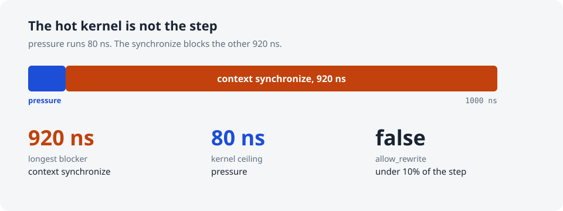
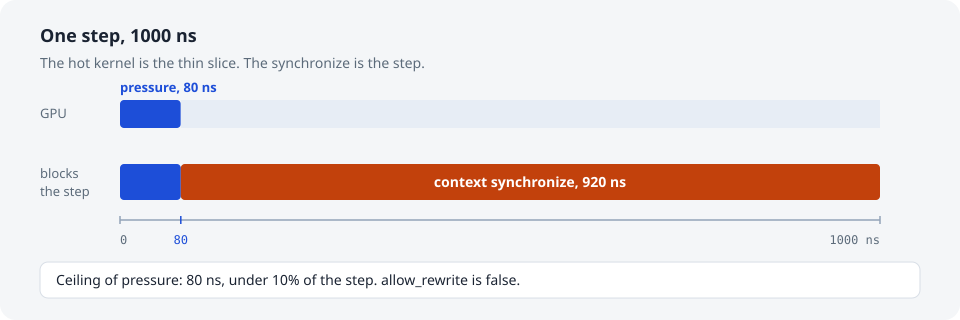
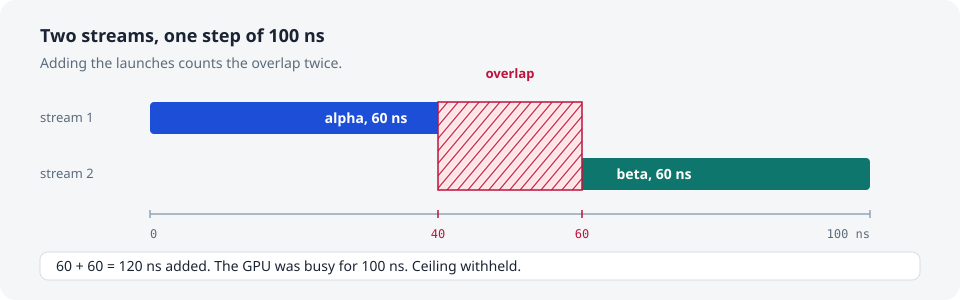
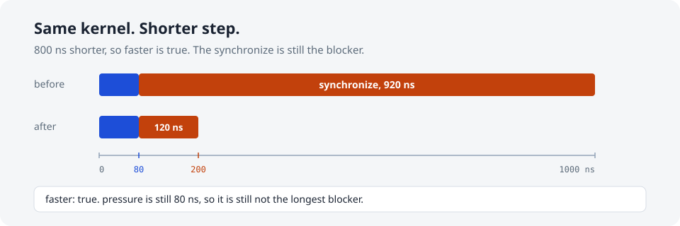

# stepceil

[](LICENSE)
[](https://www.python.org/downloads/)
[](#mcp)

**Speedup ceiling of one GPU step: time left if its hottest kernel cost nothing.**

Give stepceil one [Nsight Systems](https://developer.nvidia.com/nsight-systems) sqlite export of one NVTX range. It names the single place that blocked that step, and how much of the step the hottest kernel can still save. The command, the MCP tools, and `skill/SKILL.md` all read this same ledger. The skill does not recompute it.



[Try it](#quick-start) · [The hot kernel](#the-hot-kernel-is-not-always-the-step) · [Overlap](#overlap-is-not-a-bigger-ceiling) · [Compare](#compare-two-captures) · [Agent](#agent) · [MCP](#mcp)

## Quick start

The repository includes four small exports, so this needs no GPU. Python 3.10 or newer. The program uses the standard library only.

```bash
git clone https://github.com/Tes-bo/stepceil.git
cd stepceil
python3 -m pip install .
stepceil examples/sync.sqlite --range step
```

From a checkout before install:

```bash
PYTHONPATH=src python3 -m stepceil examples/sync.sqlite --range step
```

On your own program, mark one iteration and export sqlite. `.nsys-rep` is not opened.

```bash
nsys profile --trace=cuda,nvtx -o report ./app
nsys export --type sqlite -o report.sqlite report.nsys-rep
stepceil report.sqlite --range step
```

```c
nvtxRangePushA("step");
/* one iteration */
nvtxRangePop();
```

`--json` prints the ledger an agent should read. The range name must occur once. Push/pop (NVTX type 59) and start/end (type 60) count. Marks do not. The match is exact.

## Which name marks the step

List the names before choosing one. A name can be accounted only when `count` is 1 and `closed` is 1. `closed` is how many of those events have an end timestamp after the start. This command does not pick a window.

```bash
stepceil ranges examples/names.sqlite
```

```text
ranges: 2
name: inner
count: 4
closed: 4
name: step
count: 1
closed: 1
```

The MCP tool `step_ranges` takes `path` and returns that list as JSON.

## The hot kernel is not always the step

`pressure` runs for the first 80 ns of a 1000 ns step. `cudaDeviceSynchronize` covers the whole step, so the other 920 ns is that synchronize sitting on idle GPU time. Deleting `pressure` saves at most 80 ns. That is under 10% of the step, so `allow_rewrite` is false. The blocking piece of the synchronize starts at 80 ns, not at the start of the call.



`examples/sync.sqlite` is this step.

```text
range: step
step_start_ns: 0
step_end_ns: 1000
step_time_ns: 1000
gpu_busy_ns: 80
gpu_idle_ns: 920
assumption: single stream, no overlapping device work
longest_blocker.kind: sync
longest_blocker.name: context synchronize
longest_blocker.start_ns: 80
longest_blocker.end_ns: 1000
longest_blocker.blocking_ns: 920
longest_blocker.source: none
hottest_kernel.name: pressure
hottest_kernel.ceiling_ns: 80
hottest_kernel.instances: 1
hottest_kernel.source: none
ceiling_ns: 80
allow_rewrite: false
ceiling_refused: none
rewrite_threshold_numerator: 1
rewrite_threshold_denominator: 10
```

```json
{
  "range": "step",
  "step_start_ns": 0,
  "step_end_ns": 1000,
  "step_time_ns": 1000,
  "gpu_busy_ns": 80,
  "gpu_idle_ns": 920,
  "assumption": "single stream, no overlapping device work",
  "longest_blocker": {
    "kind": "sync",
    "name": "context synchronize",
    "start_ns": 80,
    "end_ns": 1000,
    "blocking_ns": 920,
    "source": null
  },
  "hottest_kernel": {
    "name": "pressure",
    "ceiling_ns": 80,
    "instances": 1,
    "source": null
  },
  "ceiling_ns": 80,
  "allow_rewrite": false,
  "ceiling_refused": null,
  "rewrite_threshold_numerator": 1,
  "rewrite_threshold_denominator": 10
}
```

## Overlap is not a bigger ceiling

`alpha` and `beta` each run 60 ns, on two streams, and overlap. Adding them produces 120 ns, which is longer than the 100 ns step. The GPU was busy for the union, 100 ns. This version withholds the ceiling instead of publishing the inflated sum. `ceiling_ns` is null and `allow_rewrite` is false. Busy and idle are still reported.



`examples/overlap.sqlite` is this step.

```text
range: step
step_start_ns: 0
step_end_ns: 100
step_time_ns: 100
gpu_busy_ns: 100
gpu_idle_ns: 0
assumption: overlapping device work on more than one stream
longest_blocker.kind: none
longest_blocker.name: none
longest_blocker.start_ns: none
longest_blocker.end_ns: none
longest_blocker.blocking_ns: none
longest_blocker.source: none
hottest_kernel.name: none
hottest_kernel.ceiling_ns: none
hottest_kernel.instances: none
hottest_kernel.source: none
ceiling_ns: none
allow_rewrite: false
ceiling_refused: overlapping device work on more than one stream
rewrite_threshold_numerator: 1
rewrite_threshold_denominator: 10
```

## Compare two captures

After a change, export the same NVTX range again. `faster` is true only when the later step is strictly shorter. A withheld ceiling still has a step time, so the comparison stands.

`examples/after.sqlite` is the same kernel with the synchronize cut from 1000 ns to 200 ns. The step is 800 ns shorter. `pressure` is still 80 ns, which is now at least 10% of the shorter step, so `allow_rewrite` becomes true. The synchronize still blocks the other 120 ns, so the kernel is still not the longest blocker.



```bash
stepceil diff examples/sync.sqlite examples/after.sqlite --range step
```

```text
range: step
before_step_time_ns: 1000
after_step_time_ns: 200
step_time_ns_delta: -800
faster: true
before_longest_blocker.kind: sync
before_longest_blocker.name: context synchronize
before_longest_blocker.start_ns: 80
before_longest_blocker.end_ns: 1000
before_longest_blocker.blocking_ns: 920
before_longest_blocker.source: none
after_longest_blocker.kind: sync
after_longest_blocker.name: context synchronize
after_longest_blocker.start_ns: 80
after_longest_blocker.end_ns: 200
after_longest_blocker.blocking_ns: 120
after_longest_blocker.source: none
before_ceiling_ns: 80
after_ceiling_ns: 80
before_allow_rewrite: false
after_allow_rewrite: true
before_ceiling_refused: none
after_ceiling_refused: none
```

The MCP tool `step_diff` takes `before`, `after`, and `range` and returns that same JSON.

## What the numbers mean

Device intervals are clipped to the NVTX range first. `gpu_busy_ns` is the length of the union of clipped kernel, memcpy, and memset intervals. `gpu_idle_ns` is `step_time_ns - gpu_busy_ns`.

When nothing on the device overlaps:

- Each clipped launch blocks the step for its own duration.
- The ceiling of a kernel name is the sum of its clipped launches, not the longest one.
- A synchronization call blocks the step only where it covers idle time. Time already covered by a kernel, copy, or memset stays on that operation.
- Idle time with no synchronization call is a gap named `gpu idle`.

`allow_rewrite` is true only when `ceiling_ns * 10 >= step_time_ns`. The threshold is fixed at 1/10 of the step and is repeated in the ledger.

Overlap on different streams, or different CUDA contexts, is reported as more than one stream. Overlap on one stream is reported separately, because a single stream should not do that. Intervals are half-open: a launch that ends at the timestamp another starts does not overlap it.

Times are nanoseconds. `source` is null. These sqlite tables do not carry a file and line.

## Input

| Table | Required | Role |
| --- | --- | --- |
| `NVTX_EVENTS` | yes | the step window |
| `StringIds` | yes | range text and kernel names |
| `CUPTI_ACTIVITY_KIND_KERNEL` | no | kernel launches; a missing table means none |
| `CUPTI_ACTIVITY_KIND_MEMCPY` | no | copies |
| `CUPTI_ACTIVITY_KIND_MEMSET` | no | memsets |
| `CUPTI_ACTIVITY_KIND_SYNCHRONIZATION` | no | host synchronization calls |

Kernel names come from `shortName`, then `demangledName`, then `mangledName`. NVTX text is the `text` column when it is non-empty, otherwise `StringIds` at `textId`.

Memcpy and synchronization names come from `ENUM_CUDA_MEMCPY_OPER` and `ENUM_CUPTI_SYNC_TYPE` when those tables are in the export. Nsight Systems 2022.4 numbers memcpy kinds differently from older CUPTI headers, so the file's label wins. Exports without those tables keep stepceil's short names, such as `memcpy HtoD` and `context synchronize`.

More than one `deviceId` inside the step exits 2 and prints no ledger.

## Agent

`skill/SKILL.md` is the rule sheet:

- Change `longest_blocker` first.
- Rewrite the hottest kernel only when `allow_rewrite` is true and that kernel is the longest blocker.
- When `ceiling_refused` is not null, do not rewrite kernels from that report.
- After a change, run `stepceil diff` on the two exports. Do not claim the step got faster unless `faster` is true.

## MCP

`stepceil mcp` speaks [MCP](https://modelcontextprotocol.io) on stdin and stdout. `step_ceiling` takes `path` and `range` and returns the `--json` ledger. `step_diff` compares two exports. `step_ranges` lists range names. A refused report is a tool error.

```json
{
  "mcpServers": {
    "stepceil": {
      "command": "stepceil",
      "args": ["mcp"]
    }
  }
}
```

Cursor, and any other client that launches a stdio MCP server, uses that block.

## What this version does not do

- It does not profile or rewrite kernels.
- It does not report occupancy or memory throughput.
- It does not account more than one GPU.
- It does not invent a ceiling for overlapping device work.

## Exit status

| Code | Meaning |
| --- | --- |
| 0 | A ledger was printed. A withheld ceiling is still a ledger. |
| 2 | The file is not one accountable step, or `stepceil mcp` was given arguments. |

The refusal line goes to stderr and starts with `stepceil:`.

## Develop

```bash
python3 examples/build_examples.py
python3 -m unittest discover -s tests -v
```

## License

[MIT](LICENSE).
